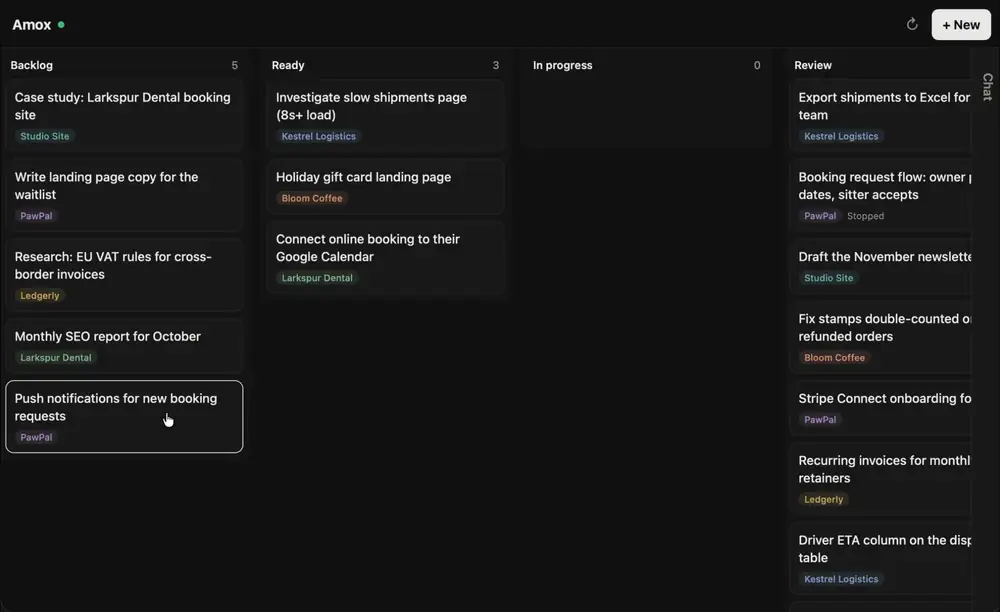
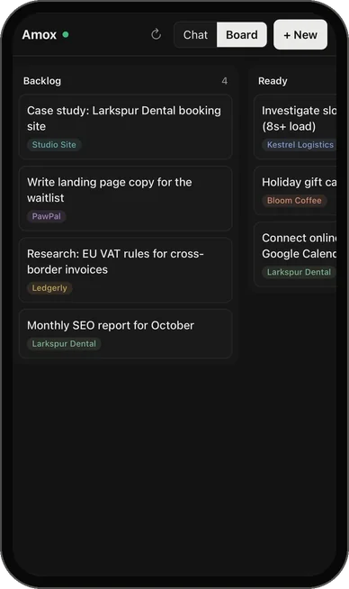

# Amox

<p>
  <a href="docs/media/demo.mp4"></a>
  &nbsp;
  <a href="docs/media/demo-phone.mp4"></a>
</p>

A kanban board for all your projects, where cards run [Claude Code](https://claude.com/claude-code) agents. Works on the laptop and the phone. No dependencies.

Each folder in your projects folder is a project. Move a card to **In progress** and Claude Code works on it in that folder. When it's done, the card goes to **Review**: approve it, or revert the changes. The chat pane has **Main**, which sees every project and manages cards, and a tab per project.

Agents run with permissions skipped by default, so they can do anything your user can. See [Safety](#safety).

## Run

Needs Node 22+, git, and Claude Code installed and logged in.

```
git clone https://github.com/maurovz/amox
cd amox
npm start
```

Open http://127.0.0.1:4700 and pick your projects folder.

## Usage

- **Cards:** Backlog, Ready, In progress, Review, Done. One running card per project; others queue.
- **Reply** on a card to continue the same session. **Stop** (or Esc) ends the run.
- **Review:** Approve keeps the changes, Reject reverts them, Redo reverts and runs again. Reverts use git and refuse if the work was pushed.
- **Tabs:** drag to reorder, ⚙ for model, effort and color, ↻ to pick up new folders, Archive to hide a project.
- **Switching folders** (⚙ on Main) switches the whole board. Each folder keeps its own in a hidden `.amox` folder, with daily backups.

## Phone

Set a token and listen on the network, then restart Amox:

```
echo "AMOX_TOKEN=$(openssl rand -hex 32)" >> ~/.amox/.env
echo "HOST=0.0.0.0" >> ~/.amox/.env
```

With [Tailscale](https://tailscale.com) on both devices, open `http://<computer>:4700/?token=<token>` once on the phone and add it to the home screen. To see the token again: `grep AMOX_TOKEN ~/.amox/.env`.

## Safety

Nobody is there to answer permission prompts, so agents skip them. Run Amox on a machine you're fine with them touching. To lock a project down, add it to `.amox/projects.json` in your projects folder:

```json
{ "projects": [{ "id": "my-app", "permissionMode": "acceptEdits", "sandbox": true }] }
```

Your deny rules and hooks still apply. Project agents can't read the board or the token.

## Config

`~/.amox/.env`: `PORT` (4700), `HOST` (127.0.0.1), `AMOX_TOKEN`, `CLAUDE_BIN`. `AMOX_HOME` moves `~/.amox`. Per-project overrides: see `projects.example.json`.

## CLI

```
node cli.js list --project my-app
node cli.js add --project my-app --title "Add dark mode"
node cli.js move <id> in_progress
```

`node cli.js` lists all commands.

## Development

```
AMOX_HOME=/tmp/amox-dev PORT=4799 node server.js
```

`server.js` is the API and agent runner, `cli.js` the card commands, `public/` the UI (no build step). Keep it dependency-free and phone-friendly.
